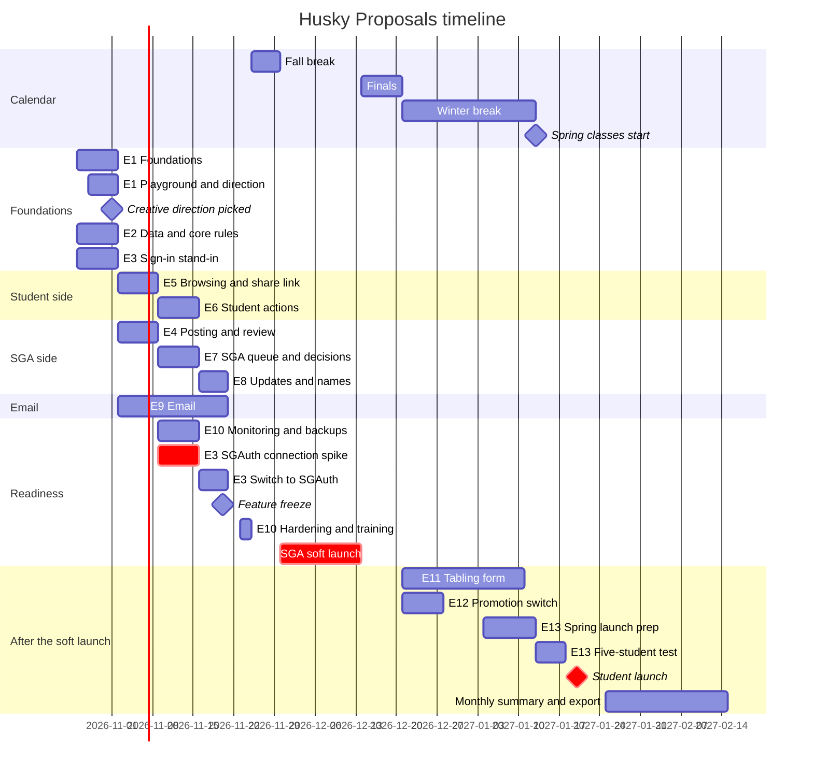

# Timeline

When each epic is planned, mapped to `feature-map.md`. Read this to find what is due. The task detail is in `build-plan.md`. The issues are the live backlog.

Updated October 23, 2026 (#9). Dates are inclusive. The chart renders on GitHub.

## Today, in short

To find what is due on a given day:
1. Find the rows in "By epic" whose dates include today. Those epics are in flight.
2. Check "Checkpoints and gates" for anything dated this week.
3. An epic past its end date that is not done is late. Say so, and apply the cut list in `build-plan.md`.
4. Check the review queue. If more than 5 pull requests are approved and waiting, merging comes before new work.

## Chart

## By epic

| Epic | Start | End | Notes |
|---|---|---|---|
| E1 Foundations | Oct 26 | Nov 1 | Scaffold, test harness, CI, port. Playground and style templates Oct 28 to Nov 1 (T0.3b) |
| E2 Data and core rules | Oct 26 | Nov 1 | Schema, `idea_stats`, rules module |
| E3 Sign-in and roles | Oct 26 | Nov 20 | Stand-in Oct 26 to Nov 1. Connection spike Nov 9 to 15. Switch Nov 16 to 20. Fallback to the stand-in if not working by Nov 27 |
| E4 Posting and review | Nov 2 | Nov 8 | |
| E5 Public browsing | Nov 2 | Nov 8 | Includes the copy-link share |
| E9 Email | Nov 2 | Nov 20 | Outbox first, decision emails, then digests |
| E6 Student actions | Nov 9 | Nov 15 | |
| E7 SGA queue and decisions | Nov 9 | Nov 15 | |
| E10 Launch readiness | Nov 9 | Dec 13 | Monitoring and backups Nov 9 to 15; hardening and training Nov 23 to 24; soft launch Nov 30 to Dec 13, with a screen reader pass. Accessibility checks run in every UI pull request |
| E8 Updates and names | Nov 16 | Nov 20 | |
| E11 Tabling form | Dec 21 | Jan 11 | Estimated at the freeze. Built over winter break if it fits |
| E12 Promotion switch | Dec 21 | Dec 27 | Off by default; only if feedback asks for it |
| E13 Spring launch prep | Jan 4 | Jan 17 | Onboarding, comms, fixes from the soft launch, and the five-student test Jan 13 to 17 |

## Checkpoints and gates

| Date | What | If missed |
|---|---|---|
| Nov 1 | D9 (appeals) answered | The decline message ships without an appeal line |
| Sun Nov 1 | Creative direction picked in the playground (T0.3b) | E5 builds on the Civic look and restyles later through the tokens |
| Sun Nov 8 | E4 and E5 merged into `dev` | Cut list items 1 to 2 (`build-plan.md`) |
| Nov 9 to 15 | SGAuth connection spike: one real sign-in on `proposals-dev`, and the environment checklist written | The switch starts late; watch the Nov 27 fallback |
| Sun Nov 15 | E6 and E7 merged. D16 (who sees names) decided | Cut list items 3 to 4 |
| Mon Nov 16 | SGAuth milestone 2 done | Stay on the stand-in; the switch moves to Nov 23 to 24 |
| Fri Nov 20 | Feature freeze. Estimate the tabling form (E11) | Anything unmerged moves after the soft launch |
| Fri Nov 27 | Real sign-in working on `proposals-dev` | The soft launch runs on the stand-in for SGA members; the switch moves to winter break |
| Mon Nov 30 | Soft launch starts on `proposals-dev` (deployed from `dev`), SGA members on the auth-dev allowlist. `dev` takes fixes only until Dec 13 | |
| Dec 14 to 20 | Finals: production breakage only | |
| Before Jan 20 | SGAuth milestone 3 live in production. D14 data policy in place | The student launch waits |
| Wed Jan 20 | Student launch, `v1.0.0` (proposed) | |
