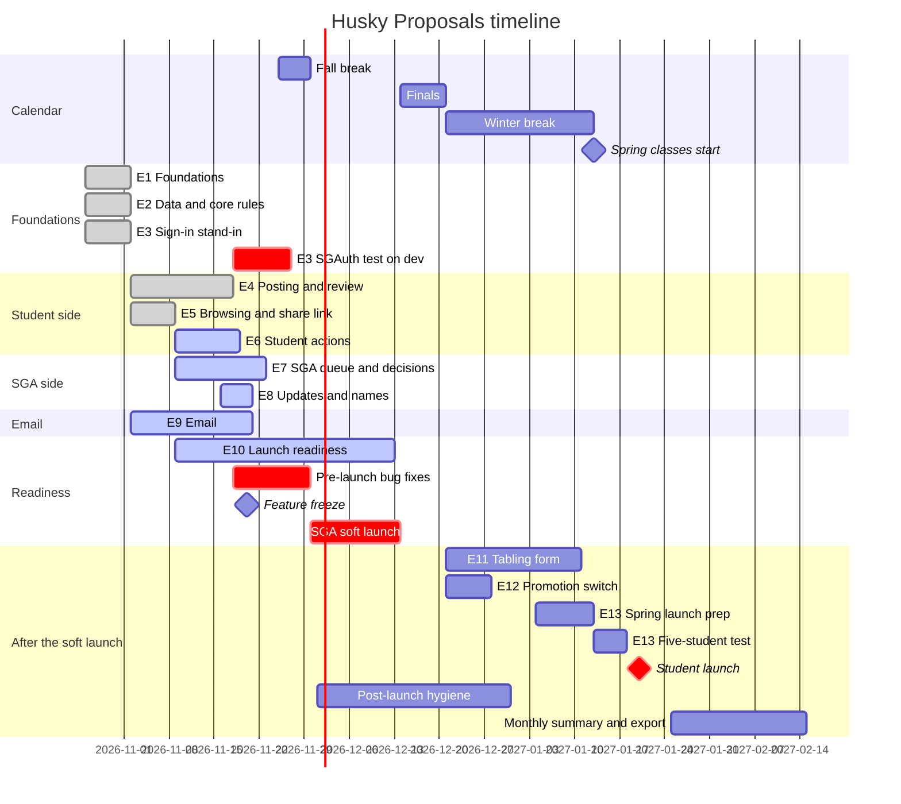

# Timeline

When each epic is planned, mapped to `feature-map.md`. Read this to find what is due. The task detail is in `build-plan.md`. The issues are the live backlog.

Updated November 18, 2026. Dates are inclusive. The chart renders on GitHub. Status reflects work merged into `dev` as of that date; "Done" marks finished epics and checkpoints, and "Active" marks work in progress.

## Today, in short

To find what is due on a given day:
1. Find the rows in "By epic" whose dates include today. Those epics are in flight.
2. Check "Checkpoints and gates" for anything dated this week.
3. An epic past its end date that is not done is late. Say so, and apply the cut list in `build-plan.md`.
4. Check the review queue. If more than 5 pull requests are approved and waiting, merging comes before new work.

## Chart

## By epic

| Epic | Start | End | Notes |
|---|---|---|---|
| E1 Foundations | Oct 26 | Nov 1 | **Done.** Scaffold, test harness, CI, port. Playground and Poster direction (#29) |
| E2 Data and core rules | Oct 26 | Nov 1 | **Done.** Schema, `idea_stats`, rules module, viewer shapes. Tracker #46 open |
| E3 Sign-in and roles | Oct 26 | Nov 27 | **Partly done.** SGAuth's milestones 1 to 3 are closed on SGAuth's side (session endpoint #40 closed Oct 23). Our wiring (#177) is closed. Real sign-in on `dev.proposals` still needs the manual test (#180), which needs Eli's allowlist and the dev environment. Stand-in in use until then. Fallback to the stand-in if not working by Nov 27 |
| E4 Posting and review | Nov 2 | Nov 8 | **Done, late.** Post, review, and resubmit (#128, PR #240) merged. Edit page is in |
| E5 Public browsing | Nov 2 | Nov 8 | **Done.** Public queries, caching, ideas list and idea page, share dialog, poster and flyer |
| E6 Student actions | Nov 9 | Nov 15 | **Active, late.** Support (#94) and follow (#101, PR #174) merged. Follow needs its abuse limit (#255, pre-launch). "I'll participate" (#95) and taps made while signed out (#102) still open |
| E7 SGA queue and decisions | Nov 9 | Nov 15 | **Active, late.** Queue (#221, PR #227) and status actions (#98, PR #225) merged. Finish and reopen (#126) waits on the Closed status (#237, PR #250, open) |
| E8 Updates and names | Nov 16 | Nov 20 | **Active.** Leader Updates tab (#130, PR #228) merged. The idea page updates section and the still-working button (#131) open |
| E9 Email | Nov 2 | Nov 20 | **Active, at risk.** The Resend mailer and bounce webhook (#209, PR #239) merged. Decision and status emails (#211, split into PRs #253 and #254) open. Emails are queued but not sent until the send route (#210) exists, and #210 is not started. Digests (#212) follow |
| E10 Launch readiness | Nov 9 | Dec 13 | **Active.** Dev migrations on push (#248, PR #252, merged). Turn-off switch (#213), quota alerts (#214), backups (#215), load test (#216), reviewer guide and training (#217), and the release checklist (#218) are open and not started. Hardening and training Nov 23 to 24; soft launch Nov 30 to Dec 13 |
| Pre-launch bug fixes | Nov 18 | Nov 27 | **Active.** Epic #259: follow limit (#255), live pages and the real pending count (#256), post and email data (#257), sign-out and hold rule (#258), and the day arithmetic (#273). Must merge before the soft launch |
| E11 Tabling form | Dec 21 | Jan 11 | Estimated at the freeze. Built over winter break if it fits |
| E12 Promotion switch | Dec 21 | Dec 27 | Off by default; only if feedback asks for it |
| E13 Spring launch prep | Jan 4 | Jan 17 | Onboarding, comms, fixes from the soft launch, and the five-student test Jan 13 to 17 |
| Post-launch hygiene | Dec 1 | Dec 31 | **Planned.** Epic #272: refactors that reduce duplication, under five rules and ratchets. About one per week, next to feature work. Nothing lands during the freeze |

## Checkpoints and gates

| Date | What | If missed |
|---|---|---|
| Nov 1 | D9 (appeals) answered | The decline message ships without an appeal line |
| Sun Nov 1 | **Done.** Creative direction picked: the Poster direction (#29) | E5 builds on the Civic look and restyles later through the tokens |
| Sun Nov 8 | **Done, late.** E4 and E5 merged. E4 finished with #128 on Nov 18 | Cut list items 1 to 2 (`build-plan.md`) |
| Nov 9 to 15 | SGAuth connection spike. SGAuth's session endpoint shipped Oct 23, and our wiring (#177) is closed. The manual sign-in test (#180) is open | The switch starts late; watch the Nov 27 fallback |
| Mon Nov 16 | SGAuth milestone 2 (session endpoint). **Done early, on Oct 23** | None |
| Wed Nov 18 | Merged today: dev migrations (#252), Next.js 16.4.6 (#236), font fallback (#234), People page (#233), edit and resubmit (#240), Resend mailer (#239), People follow-up (#241). **At risk:** the send route (#210) is not started, so decision emails queue but do not send | Decision emails wait for #210 |
| Fri Nov 20 | Feature freeze. Pre-launch bugs (#255 to #258, #273) must be merged or moved. Unmerged feature PRs (#250, #251 split, #237, #211) move after the soft launch | Anything unmerged moves after the soft launch |
| Fri Nov 27 | Real sign-in working on `dev.proposals` (#180) | The soft launch runs on the stand-in for SGA members; the switch moves to winter break |
| Mon Nov 30 | Soft launch starts on `dev.proposals` (deployed from `dev`), SGA members on the dev.auth allowlist. `dev` takes fixes only until Dec 13 | |
| Dec 14 to 20 | Finals: production breakage only | |
| Before Jan 20 | SGAuth milestone 3 live in production. D14 data policy in place | The student launch waits |
| Wed Jan 20 | Student launch, `v1.0.0` (proposed) | |
