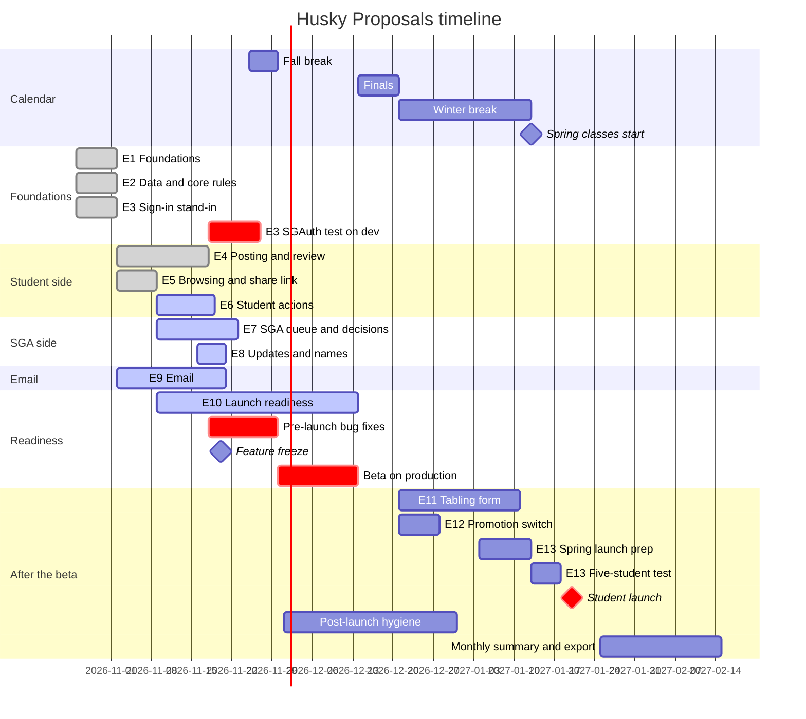

# Timeline

Updated November 18, 2026. The beta is now a beta on production (`main`). Dates are set in the project's Target date field once #279 lands. Until then, this file is the source. Each section starts with what to do. Tickets are GitHub issues; `#N` is the issue number.

## What to do now

Wednesday, November 18, to Friday, November 20 (feature freeze)

- **Work on the pre-launch bugs (#259).** Plan and build #255 (follow limit), #256 (live pages and pending count), #257 (post and email data), #258 (sign-out and hold rule), and #273 (day arithmetic). Each merges by Friday or moves after the beta.
- **Merge #253, then #254** (decision emails, split from #211). #251 is superseded. Close it without merging.
- **Merge #249** (error floater). It is ready for review.
- **Finish #126** (leader panel: start, hold, finish, reopen). It is on the Feature freeze milestone. Merge by Friday or move.
- **Finish #131** (idea page updates and the still-working button). E8 ends Friday.
- **Merge #275** (the docs batch: timeline, SGAuth status, refactor rules).
- **Write the send route (#210).** Decision emails queue until it exists. It goes on the Feature freeze milestone, with #211.
- **Set the milestones (needs a go-ahead):** move the E10 readiness milestone to December 13 and put #210 on Feature freeze.

## What to do next

Monday, November 23, to Friday, November 27

- **Work on hardening and training (E10, Nov 23 to 24).** Switch (#213), quota alerts (#214), backups (#215), load test (#216), reviewer guide and training (#217), release checklist (#218). The E10 end date is December 13. These are readiness work, so they may slip into the beta week.
- **Get production sign-in ready (#180, E3).** The beta runs on `proposals.northeasternsga.com`, so real sign-in there needs Husky Proposals registered in SGAuth's product registry and the production subdomain added. Both are listed under "To ask" in `sgauth-integration.md`. This is a registration, not a test-account allowlist. Luis raises it with Eli. Needed by Friday, November 27.
- **Confirm the production database path.** List pending migrations (`git diff --stat main..dev -- prisma/migrations`) and check each only adds. Production migrations are run by hand, before the release merges (`dev-process.md`).
- **Confirm the beta gates (E10).** The switch (#213), alerts (#214), and backups (#215) are needed before real use on production. The load test (#216), guide and training (#217), and release checklist (#218) go with them. See Decisions.
- **Work on Target dates (#279).** Start with the tickets this timeline names. This is what makes `npm run due` work.

## What to do during the beta

Monday, November 30, to Sunday, December 13

- **Release v0.9.0 from `dev` to `main`** with `/port:release`, once #255 to #258 and #273 are merged. Run the production migration by hand first. Then announce the beta to SGA members and the five boards.
- **Finish the E6 leftovers (#95, #102).** Both are late; E6 ended November 15.
- **Ship beta fixes as releases.** Fixes for the beta go to `main` by release, or as a hotfix for production breakage. `dev` keeps its feature work.
- **Start post-launch hygiene (#272) on December 1, on `dev`.** Refactors ship in regular releases, one pattern per pull request, each passing the full test suite.

## What to do after

- **Finals, December 14 to 20.** Production breakage only.
- **Winter break, from December 21.** Build the tabling form (E11, estimated; only if it fits). Build the promotion switch (E12) only if feedback asks for it.
- **Spring prep, January 4 to 17 (E13).** Onboarding, comms, fixes from the beta. Run the five-student test January 13 to 17.
- **Student launch, Wednesday, January 20.** Tag v1.0.0 (proposed).

## Decisions

- **November 18:** E10 readiness ends December 13 (not the freeze). #210 sits on the Feature freeze milestone.
- **November 18:** Hygiene opens December 1 on `dev`, not in the beta.
- **November 18:** #126 and #211 merge by November 20, or move after the beta.
- **November 18:** The beta (formerly the beta) runs on production, from `main`, as v0.9.0 on November 30. It does not run on dev.
- **November 18:** No dev allowlist requests. Dev sign-in is not part of the beta, so #180's dev test is replaced by the production sign-in gate above.
- **Open:** whether the beta gates on E10 (switch, alerts, backups) hold the November 30 date, or whether the beta starts with a smaller set.
- **Open:** whether the D14 data policy must be in place before the beta, since the beta uses real student data on production.

## Chart

## By epic

| Epic | Start | End | Status and notes |
|---|---|---|---|
| E1 Foundations | Oct 26 | Nov 1 | **Done.** Scaffold, test harness, CI, Poster direction (#29) |
| E2 Data and core rules | Oct 26 | Nov 1 | **Done.** Schema, `idea_stats`, rules, viewer shapes |
| E3 Sign-in and roles | Oct 26 | Nov 27 | **Partly done.** SGAuth session endpoint and production milestone closed. Production needs Husky Proposals registered in SGAuth's registry and the production subdomain (#180). The stand-in runs in local and test only |
| E4 Posting and review | Nov 2 | Nov 8 | **Done, late.** Post, review, and resubmit (#128, PR #240), edit page |
| E5 Public browsing | Nov 2 | Nov 8 | **Done.** Queries, caching, ideas list, idea page, share dialog, poster and flyer |
| E6 Student actions | Nov 9 | Nov 15 | **Active, late.** Support and follow merged. Follow's abuse limit (#255) is pre-launch. "I'll participate" (#95) and signed-out taps (#102) open |
| E7 SGA queue and decisions | Nov 9 | Nov 22 | **Active.** Queue and status actions merged. Closed status (#237, PR #250) merged November 18. Finish and reopen (#126) open |
| E8 Updates and names | Nov 16 | Nov 20 | **Active.** Leader Updates tab merged. Idea page updates and still-working button (#131) open |
| E9 Email | Nov 2 | Nov 20 | **Active, at risk.** Resend mailer and bounce webhook merged. Decision and status emails split into #253 and #254. Send route (#210) not started |
| E10 Launch readiness | Nov 9 | Dec 13 | **Active.** Dev migrations merged (#248, PR #252). Switch (#213), alerts (#214), backups (#215), load test (#216), reviewer guide (#217), release checklist (#218) open |
| Pre-launch bug fixes | Nov 18 | Nov 29 | **Active.** Epic #259. Must merge before the beta |
| E11 Tabling form | Dec 21 | Jan 10 | Estimated. Built over winter break if it fits |
| E12 Promotion switch | Dec 21 | Dec 27 | Off by default. Only if feedback asks for it |
| E13 Spring launch prep | Jan 4 | Jan 17 | Onboarding, comms, fixes, five-student test Jan 13 to 17 |
| Post-launch hygiene | Dec 1 | Dec 31 | **Planned.** Epic #272, on `dev`. About one refactor a week |

## Checkpoints and gates

| Date | What | If missed |
|---|---|---|
| Nov 1 | D9 (appeals) answered | Decline message ships without an appeal line |
| Nov 8 | E4 and E5 merged | Cut list items 1 to 2 |
| Nov 9 to 15 | SGAuth connection spike; manual sign-in test (#180) open | Switch starts late |
| Nov 16 | SGAuth session endpoint (done early, Oct 23) | None |
| Wed Nov 18 | Merged today: #250, #252, #236, #234, #233, #240, #239, #241. At risk: send route (#210) | Decision emails wait for #210 |
| Fri Nov 20 | Feature freeze. #255 to #258 and #273 merge or move. #126 and #211 merge or move | Anything unmerged moves after the beta |
| Fri Nov 27 | Production sign-in ready: Husky Proposals registered in SGAuth, production subdomain added (#180) | The beta waits. The stand-in does not run in production |
| Mon Nov 30 | Beta starts: v0.9.0 released from `main`, production migrated | The beta waits |
| Dec 14 to 20 | Finals: production breakage only | |
| Before Jan 20 | SGAuth milestone 3 live in production; D14 data policy in place | Student launch waits |
| Wed Jan 20 | Student launch, v1.0.0 (proposed) | |
